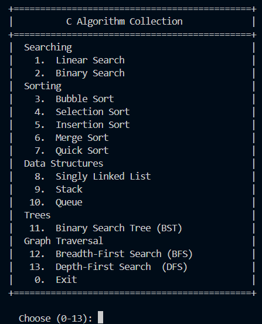

# C Algorithm Collection

A collection of 13 classic algorithms and data structures implemented in C, each with a terminal visualizer that animates every step in real time.



---

## Algorithms Included

| # | Algorithm | Category |
|---|-----------|----------|
| 1 | Linear Search | Searching |
| 2 | Binary Search | Searching |
| 3 | Bubble Sort | Sorting |
| 4 | Selection Sort | Sorting |
| 5 | Insertion Sort | Sorting |
| 6 | Merge Sort | Sorting |
| 7 | Quick Sort | Sorting |
| 8 | Singly Linked List | Data Structures |
| 9 | Stack | Data Structures |
| 10 | Queue | Data Structures |
| 11 | Binary Search Tree (BST) | Trees |
| 12 | Breadth-First Search (BFS) | Graph Traversal |
| 13 | Depth-First Search (DFS) | Graph Traversal |

---

## Prerequisites

You need **GCC** installed and available in your terminal.

### Windows (MSYS2 — recommended)

1. Download and install [MSYS2](https://www.msys2.org/)
2. Open the **MSYS2 UCRT64** terminal and run:
   ```bash
   pacman -S mingw-w64-ucrt-x86_64-gcc
   ```
3. Add `C:\msys64\ucrt64\bin` to your Windows PATH:
   - Search **"Edit the system environment variables"** → Environment Variables
   - Under **User variables**, select `Path` → Edit → New → paste `C:\msys64\ucrt64\bin`
   - Click OK and restart your terminal
4. Verify:
   ```powershell
   gcc --version
   ```

### macOS

```bash
xcode-select --install
```

### Linux (Debian/Ubuntu)

```bash
sudo apt update && sudo apt install gcc
```

---

## Clone & Run

```bash
git clone https://github.com/sannyuntwin/dsa-by-c.git
cd dsa-by-c
```

**Compile the launcher:**

```bash
gcc main.c -o main
```

**Run:**

```bash
# Windows
.\main.exe

# macOS / Linux
./main
```

You'll see an interactive menu. Pick a number (1–13) to compile and run that algorithm's visualizer. Press `0` to exit.

---

## Run a Single Algorithm

Each `.c` file is standalone and can be compiled and run on its own:

```bash
gcc sorting/bubble-sort.c -o bubble-sort
./bubble-sort        # macOS/Linux
.\bubble-sort.exe    # Windows
```

---

## Project Structure

```
c-algorithm/
├── main.c                          # Interactive menu launcher
├── README.md
├── searching/
│   ├── linear-search.c
│   └── binary-search.c
├── sorting/
│   ├── bubble-sort.c
│   ├── selection-sort.c
│   ├── insertion-sort.c
│   ├── merge-sort.c
│   └── quick-sort.c
├── data-structures/
│   ├── singly-linked-list.c
│   ├── stack.c
│   └── queue.c
├── trees/
│   └── bst.c
└── graph/
    ├── bfs.c
    └── dfs.c
```
